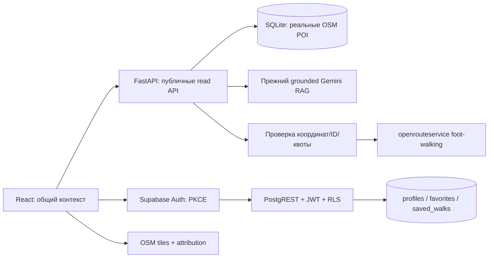
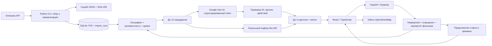

# Архитектура

## Phase 5: текущая архитектура

Прежний recommendation/chat pipeline сохранён. Новые независимые границы: `services/routing.py` получает публичные POI только из SQLite, вызывает официальный ORS `foot-walking/geojson` с серверным ключом и возвращает проверенную геометрию. `useWalkingRoute` хранит только текущий маршрут, отменяет устаревшие запросы и пересчитывает путь при смене подтверждённого старта. GeoJSON `[longitude, latitude]` переводится в Leaflet `[latitude, longitude]` только при отображении; fallback-линий нет. Старт по умолчанию требует подтверждения именно перед маршрутизацией.

`AccountProvider` использует официальный Supabase JS, PKCE, восстановление сессии и отложенное сохранение после входа. Supabase Auth проверяет токены для PostgREST; Python не доверяет и не обрабатывает переданный клиентом user_id. Все личные таблицы защищены RLS/column grants из `supabase/migrations`. POI остаются в SQLite; `POST /api/pois/resolve` повторно читает сохранённые OSM ID и явно сообщает отсутствующие. Сохранённая прогулка содержит порядок ID и allowlist предпочтений, без GPS, сообщений и геометрии.

`App` держит общий старт, фильтры, результат и выбранный ID; сохранённые места имеют отдельный временный набор для карты, чтобы открытие профиля/сохранения не уничтожало рекомендации и историю чата. Открытие сохранения отменяет старый поиск/чат. Смена старта при активном маршруте сохраняет результаты и явно помечает старые оценки карточек. Закрытие выбора старта и навигация аннулируют ожидающий GPS callback. Аккаунт — доступный dialog; после входа продолжается запрошенное сохранение, без обязательной регистрации на главной.

Публичные API: `/api/health`, `/api/data-status`, `/api/pois`, `/api/pois/resolve`, `/api/recommendations`, `/api/chat`, `/api/routes`. Импорт остаётся локальным CLI. ORS: максимум три остановки и необязательное возвращение, ограниченная область Астаны, таймаут, ограничение ответа/геометрии и snapping. По умолчанию не более 20 routing запросов/минуту и двух одновременных; recommendation/chat делят 30/минуту и два одновременных. Это process-wide защита, без сохранения IP; для нескольких workers нужна общая квота. Отсутствие ключа возвращает явный статус, а не ложный маршрут.

Статус внешней настройки и тестов фиксирует [Phase 5 report](PHASE5_COMPLETE_REPORT.md). Миграции подготовлены, но не применены автоматически; живые ORS и RLS-проверки до настройки не подтверждены.

## Историческая основа представлений — Phase 4

`App.tsx` держит пять представлений: `home`, `plan`, `results`, `chat`, `map`. Выбор представления записывается в History API без перезагрузки страницы. Точка старта, фильтры, единый RecommendationResponse, выбранный ID и прежний `useCityChat` находятся над представлениями. Навигация сохраняет данные; редактирование условий и «Новый диалог» явно аннулируют устаревшие результаты. Панель чата сохраняется скрытой при переходах, поэтому не теряет черновик.

Путь A отправляет запрос из главной, B использует общий `FilterControls`, C использует существующие ChatPanel/useCityChat. Активный контекст продолжает использовать `/api/chat` и при обычном поиске. Нового recommendation engine или AI endpoint нет. Backend, схема SQLite, Gemini JSON Schema fix, grounding и импорт этой фазой не менялись.

CityMap и CSS Leaflet вынесены в динамический import. До явного открытия карты не создаётся Leaflet, не запрашиваются тайлы и ближайшие POI для карты. После открытия экземпляр сохраняется скрытым при возврате, удерживая viewport; изменение выбранного ID/selectionRevision фокусирует конкретное место, а новый набор результатов обновляет общий обзор. Смена старта кликом допускается только при `picking=true`. Мобильное представление карты имеет явный возврат, desktop — список рядом с картой. Карта не является маршрутизатором.

Клавиатурный фокус следует основному содержимому/результатам, native dialog возвращает фокус вызвавшей кнопке. Отложенный ответ исторического выбора не открывает карту после ухода из диалога, включая browser Back. Все новые тексты находятся в `frontend/src/i18n/ru.ts`, стили используют общие токены. [Аудит, проверки и ограничения Phase 4](PHASE4_PRODUCT_AUDIT.md).

Frontend раздаётся Vite; `/api` проксируется на 127.0.0.1:8000. Точное положение хранится только в состоянии React и теле запроса, не в URL/localStorage. Изменение условий аннулирует старый результат и отменяет незавершённый запрос. Отмена в браузере не гарантирует отмену уже начавшегося серверного вызова Gemini, но таймаут ограничен.

`services/intent.py` выделяет категории, основные интересы, исключения, прогулку/отдых, строгие условия и простой бюджет времени. Название старта ищется по импортированным алиасам; ответ предлагает максимум три реальные точки для подтверждения. `applied_duration_minutes`, `suggested_duration_minutes` и `origin_suggestions` делают интерпретацию запроса видимой. Текст не меняет выбранные координаты.

Ранжирование учитывает тип достопримечательности и документированную идентичность OSM, точное упоминание имени, расстояние и оставшееся время. До 12 кандидатов сохраняют представителей запрошенных категорий; fallback покрывает основные интересы, затем добавляет разнообразие. Это эвристика релевантности, не рейтинг популярности. Для Gemini отправляется только структура намерений, без исходного запроса.

SQLAlchemy хранит модель POI с устойчивым `osm_type/osm_id`, исходными тегами, координатами, источником и временем импорта. `search_text` нормализуется Unicode NFKC + casefold + ё→е. Для небольшого городского набора используется SQL bounding box и сканирование отобранных кандидатов в Python. Эмбеддинги/FTS не обязательны для этого baseline.

Импорт ограничен одним bbox и именованными категориями. Предыдущие данные не меняются до успешного получения и нормализации снимка. Upsert, удаление отсутствующих ID и запись `ImportRun` выполняются одной транзакцией. Сырой снимок сохраняется до транзакции. Ошибка сохранения снимка прерывает импорт; ошибка транзакции откатывает базу.

HTTP API: health, data-status, bounded `/pois` (limit ≤100, offset ≤10000, bbox/q/category), recommendations и chat. Нет HTTP-администрирования. Swagger отображает Pydantic-схемы. CORS ограничен двумя локальными frontend-origin; сервера привязаны к loopback.

`POST /api/chat` — ограниченный адаптер `services/chat.py` поверх того же `recommend()`. Он принимает текущую реплику, подтверждённый старт, типизированные предпочтения и ограниченные ID истории. Локальные правила объединяют уточнения и новые UI-действия, затем переводят состояние в проверенный словарь существующего intent processing. Raw transcript и точные координаты не передаются Gemini. Повторный выбор и возврат проходят общий retrieval с ограничением ID и актуальными условиями; «ещё» исключает просмотренные места до top-12, «ближе» меняет приоритет расстояния. Второй независимой рекомендательной системы нет.

`useCityChat.ts` держит восемь сообщений и компактный контекст в памяти вкладки. Активный чат и обычная кнопка поиска используют один контекст, фильтры и `RecommendationResponse`; без контекста обычный поиск сохраняет прежний endpoint. ChatPanel, карточки и Leaflet получают общий выбранный ID. AbortController и проверка идентичности запроса защищают от поздних ответов; сброс контекста не требует сервера. Подробнее: [Phase 3](PHASE3_REPORT.md).

Слои конфигурации/ORM позволяют сменить DATABASE_URL, но POI в Phase 5 остаются в SQLite. Её схема создаётся `create_all`. Отдельная Supabase PostgreSQL хранит персональные данные и использует версионированную SQL migration.

E2E запускает отдельный `backend/tests/e2e_server.py`: временная SQLite, синтетические POI и отключённый Gemini. Vite использует `AITU_API_TARGET` для тестового backend. Обычный запуск остаётся на 8000/5173. Импорт настоящих данных проверяется отдельным `scripts/smoke.py`; `scripts/audit_data.py` выполняет аудит без сетевых запросов.
