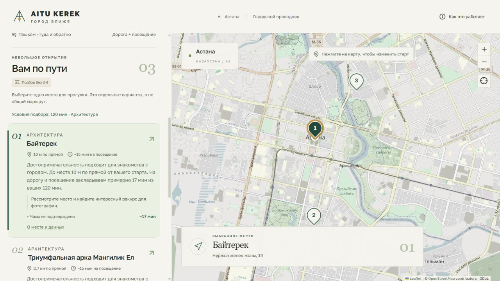

# AITU KEREK — Phase 2

17 октября 2026. Изменён существующий проект, стек, источники и дизайн сохранены.

## 1. Что было обнаружено

- Поиск подстрок не понимал отрицания; «кофе и погулять» сводился к кафе. Длительность из фразы не разбиралась.
- Близость и совпадения слов могли вытеснять значимые достопримечательности случайными объектами. Fallback стремился к разнообразию даже при слабой релевантности.
- Название старта из текста не превращалось в проверяемое предложение. Конфликт с фильтрами объяснялся недостаточно явно.
- Gemini получал сырой запрос, в котором пользователь мог сам написать координаты. Объяснения были почти одинаковыми.
- Позитивные E2E зависели от наличия Mega и непустого живого импорта. Близкие метки перекрывались; автоматическое приближение первой скрывало остальные.

## 2. Что улучшено

Добавлен компактный слой intent processing с ru/en/kk-словарями, простыми отрицаниями, сочетаниями интересов, временем и предупреждениями. Выбранные условия не меняются молча. Предлагаемые старт и время подтверждаются отдельными кнопками с пересчётом.

Ранжирование учитывает смысл категории, тип достопримечательности, документированную идентичность, точное имя, расстояние и запас времени. Запрошенное кафе не теряется даже среди плотного набора парков. Для прогулки повышается приоритет парков, для осмотра города — подходящих достопримечательностей. Каждая карточка остаётся отдельным вариантом.

Сохранены палитра, шрифты, левая панель и карта. Усилены активные карточки и метки, контраст вторичных текстов; после поиска результаты получают фокус и прокрутку. Все новые результаты остаются в обзоре карты. Близкие значки разнесены линиями к настоящим координатам. Ошибка тайлов не исчезает от одного успешного тайла; есть повтор загрузки и offline-состояние.

Проведён аудит: **549 POI**, число совпадает с документацией и import_run. По действующим правилам 0 дублей, 0 ошибок источников, 0 расхождений классификатора и 0 координат вне bbox. Часы отсутствуют у 416 объектов, не поддерживаются у 56; `fee=no` есть только у одного. База и секреты не изменялись; новых запросов Overpass не было.

## 3. Как теперь работает обработка запросов

- «Кофе и погулять» сохраняет оба основных интереса; «не хочу кафе, лучше парк» исключает кафе.
- «Спокойно провести час» предлагает парки/кафе как варианты отдыха, не обещая тишину. «Необычные места» включает ранжирование достопримечательностей.
- «Бесплатно погулять» требует именно `fee=no`, без предположений по отсутствующему тегу.
- Поддерживаются «40 минут», «два часа», «полчаса», диапазон «30–60 минут», некоторые en/kk формы. Явная длительность выигрывает; расхождение показано с кнопкой применения. API без явного времени использует распознанную длительность.
- «Я возле Mega Silk Way» сопоставляется с настоящими именами/алиасами. Пока пользователь не подтвердил предложение, применяется прежний старт. Возможны до трёх неоднозначных совпадений.
- Фильтры категорий имеют приоритет с предупреждением. При внутреннем противоречии, исключившем все положительные категории, возвращается пустая выдача.

Внешних NLP-сервисов, embeddings и векторной базы нет. Правила не претендуют на понимание произвольной речи.

## 4. Что изменилось в Gemini RAG

Цепочка: intent → географический retrieval → ranking → до 12 реальных кандидатов → официальный Google SDK / Pydantic → независимый grounding → карточки.

Сырой текст пользователя больше не передаётся модели. Контекст содержит разобранные намерения, реальные кандидаты, ранги, оценки и разрешённые коды. Точные координаты и упомянутый старт исключены; приблизительная область может быть понятна по кандидатам/расстояниям.

Запрещены лишние поля, неизвестные ID, повторные объекты/причины и неподтверждённые действия/утверждения. Проверяется покрытие двух-трёх доступных основных интересов. Любое нарушение включает детерминированный fallback. Объяснение содержит соответствие интересу, расстояние по прямой и бюджет времени; факты берутся из SQLite.

**Live Gemini не проверен:** непустого ключа в `backend/.env` нет. Проверены реальные SDK-типы и контракт с подменой сетевого клиента, без имитации успешного внешнего вызова. Ключ не выводился и не редактировался.

## 5. Какие тесты добавлены

Backend: **36 дополнительных случаев** к прежним 54. Три сценария, ru/en/kk, отрицания, время, явные фильтры, подтверждение старта, пустой результат, неизвестные часы, точная арифметика бюджета, плотные парки со смешанным интересом, именованный объект, конфликт категорий, отсутствие приватного сырого текста в SDK, grounding и fallback при пропущенном интересе/дублях/лишнем факте.

Playwright: **6 новых сценариев** к прежним 9. Позитивные проверки перенесены на настоящий backend с временной тестовой SQLite. Существующие проверки не удалены; дефект перекрытия меток исправлен в приложении, исходная проверка нажатия сохранена. Отдельный smoke работает с реальной базой. Тестовые POI никогда не попадают в рабочую SQLite.

## 6. Какие проверки успешно выполнены

| Проверка | Результат |
|---|---|
| pytest | **90 passed** |
| Ruff | Passed, backend и scripts |
| ESLint | Passed |
| TypeScript typecheck | Passed |
| Production build | Passed |
| Playwright / Microsoft Edge | **15 passed** |
| API smoke на реальных данных | A/B/C + источники/ID/бюджет/часы/предложения — Passed |
| Аудит данных | 549 POI, проверенные инварианты соблюдены |
| Визуальная проверка | Живые OSM-тайлы, desktop и 390 px; консоль без ошибок в проверенном состоянии |

Рабочие порты были заняты; текущая версия для QA запущена на 8002/5175. Пользовательские процессы не трогали. E2E использует собственные 8001/5174. Подробные команды, снимки данных и наблюдения — в [VERIFICATION](VERIFICATION.md).

## 7. Что осталось ограничением

- Простые языковые правила: сложные отрицания, опечатки, сравнения времени и диалог могут быть поняты неверно. Кнопки условий надёжнее.
- Значимость оценивается по неполным OSM-тегам; это не экспертный рейтинг города. Аудит проверяет согласованность данных, а не их истинность на местности.
- Часы/цены часто неизвестны. Строгий бесплатный фильтр может вернуть пусто. Розетки, тишина, свободные места и события не подтверждаются.
- Реальный маршрут, переходы, входы и доступность не строятся. Часы проверяются на момент запроса; оценки визита фиксированы по категории.
- Нет успешного live Gemini, проверки другого ПК или публичного развёртывания. Сохраняются два deprecation-предупреждения внешних Python-зависимостей; итоговые тесты проходят.
- Offline проверен отказом тайлов и событием браузера; физическое отключение адаптера не выполнялось.

## 8. Как проверить улучшения вручную

Из папки проекта запустите `scripts/start.ps1`; если старый экземпляр работает, сначала остановите его в его терминале. При имеющейся базе повторный импорт не нужен. Откройте [приложение](http://localhost:5173).

**A — Quick Walk:** в «Точка старта» найдите Mega Silk Way, выберите его; 60 минут, «Хочу погулять». В проверенном снимке: NU Park (40 мин), Японский сад (42), Аллея мира и согласия (48). Откройте источник и сравните метку. Это три отдельных варианта.

**B — Coffee & Relax:** выберите центр возле Байтерека, 60 минут, «Ищу тихое кафе с розетками, посидеть и отдохнуть». Должны появиться кафе и предупреждение о неподтверждённых условиях. В живом smoke: CrepeCafe, Degirmen, Drinkit; часы неизвестны. Не представляйте неизвестные свойства жюри как факты.

**C — Explore Astana:** центр возле Байтерека, 2 часа, «Хочу посмотреть необычные достопримечательности». В проверенном снимке: Байтерек (17 мин), Триумфальная арка Мангилик Ел (103), памятник Шарлю де Голлю (79). Все метки должны быть видны сразу; карточка и метка выбирают друг друга.

Дополнительно: оставьте старт в центре и введите «Я возле Mega Silk Way, у меня 40 минут». Убедитесь, что сначала сохранены прежняя точка и 60 минут; подтвердите новый старт, затем 40 минут. Проверьте «кофе и погулять» и «не хочу кафе, лучше парк». Для конфликта выберите фильтр «Кофе» и повторите последнюю фразу: фильтр сохранится с объяснением.

Запуск проверок: `scripts/check.ps1 -Browser`. Отдельно при работающем backend: `.venv/Scripts/python.exe scripts/smoke.py`; аудит без сервера: `.venv/Scripts/python.exe scripts/audit_data.py`. Не изменяйте реальную базу для демонстрации пустого состояния.

