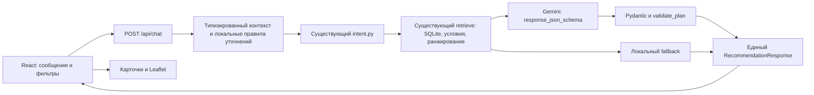

# AITU KEREK — Phase 3: контекстный городской помощник

Проверено 17 октября 2026 на Windows, Python 3.14.4, Node.js 24.19.0. Работа выполнена в существующем приложении. Стек, дизайн-система, рабочая SQLite и `.env` сохранены; новые зависимости и серверное хранилище диалогов не добавлялись. Git push не выполнялся.

## 1. Что реализовано

В левой панели появился раскрываемый блок «Спросить помощника». Чат поддерживает уточнения времени, интересов, запреты категорий, бесплатность по OSM, приоритет близости, другие варианты и возврат к предыдущей подборке. Он использует тот же результат, что карточки и Leaflet: выбор места подсвечивает одинаковый POI во всех трёх представлениях. Повторный клик по выбранному месту возвращает карту к нему после ручного перемещения, без сетевого запроса.

Есть последние восемь сообщений, подсказки первого запроса, Enter для отправки, Shift+Enter для новой строки, индикатор ожидания, повтор после ошибки и «Новый диалог». Новый диалог очищает сообщения, предпочтения, результаты и фильтры; явно выбранный старт сохраняется. Перезагрузка страницы очищает всю память. На mobile работает существующий переключатель «Подбор / Карта»; кнопка выбора старта из чата открывает карту.

## 2. Архитектура и память



`useCityChat.ts` хранит состояние только в памяти React и передаёт компактный `ChatContext`. В нём: текущие предпочтения, до трёх показанных/предложенных ID, выбранный ID, до восьми снимков подборок и до 96 просмотренных ID. Сервер не хранит сессии. Контекст не содержит текста сообщений, координат или скопированных свойств POI. Текущая подтверждённая позиция передаётся отдельно только для поиска. Неподтверждённый центр карты не становится стартом чата автоматически.

Контекст от браузера считается недоверенным: поля, длины, enum и формат ID проверяются Pydantic. Исторический выбор, возврат и подтверждение старта повторно читают POI из SQLite. «Предыдущие варианты» восстанавливают подходящие ID **под текущими** ограничениями; старое время или запрет кафе не откатываются. Если место удалено или больше не подходит, помощник честно сообщает об этом.

## 3. Уточнения и приоритет интерфейса

- «Два часа» → 120 минут; «теперь только 30 минут» меняет только время.
- «Без кафе» сохраняется при последующих «поближе», «ещё» и смене времени. Новое явное желание кафе или выбор кафе в фильтре снимает соответствующий запрет.
- «Бесплатно» сохраняет строгий `fee=no`; неизвестная цена не становится бесплатностью.
- «Поближе» меняет порядок кандидатов в общем retrieval, сохраняя остальные условия. Это близость по прямой.
- «Ещё» исключает просмотренные ID и близкие алиасы **до** ограничения пула 12 кандидатами. При исчерпании остаются текущие результаты с объяснением.
- Сначала применяются новые действия интерфейса поверх старого контекста, затем текущая реплика. Поэтому более новое «теперь 30 минут» может уточнить ранее выбранные 60 минут.
- Неоднозначное или отсутствующее название старта требует уточнения. «Возле Байтерека» поддерживается по реальному OSM-алиасу с ограниченной обработкой русского падежа; автоматического переноса точки нет.
- Во время активного диалога обычная кнопка поиска использует тот же контекст чата, сохраняя исключения и близость. Старый поисковый текст очищается при обращении к чату и не выдаётся за новое пожелание. Без контекста обычный `/api/recommendations` работает как раньше.

Противоречивое «Хочу кафе, но без кафе» вызывает уточнение, без расширения выдачи на случайные категории.

## 4. Grounding, fallback и приватность

Gemini получает разобранные намерения и реальные кандидаты из существующего RAG. Исходная реплика, история, точные пользовательские координаты и произвольные клиентские факты в модель не передаются. Интерпретация контекста ограничена локальными правилами; модель выбирает 1–3 POI и разрешённые коды объяснений/действий. Свободный фактический ответ модели не отображается.

Сохранено исправление `response_json_schema=GeneratedPlan.model_json_schema()`, `extra="forbid"`, строгий разбор JSON и `validate_plan()`. Неизвестные ID, лишние факты, повторные места, неподтверждённые причины/действия и пропущенные доступные основные интересы приводят к локальному fallback. Диагностика остаётся `call / parse / grounding` с фиксированными кодами без ключей, координат, текста запросов, сырых ответов и SDK traceback.

При отсутствии ключа или сбое Gemini чат продолжает локальный подбор и прямо показывает «без ИИ». Уточнение старта и возврат к уже найденным ID также локальные. Повторный выбор пересчитывает допустимость и факты без дополнительного Gemini-вызова. Неподдерживаемая свободная беседа получает объяснение границ помощника вместо выдуманных сведений.

Пустые сообщения, ввод длиннее 600 символов и лишние поля отклоняются; повторная отправка блокируется. Изменение фильтров/старта, новый поиск и новый диалог отменяют текущий браузерный запрос. Проверка идентичности запроса и abort-сигнала не позволяет опоздавшему ответу заменить новые данные. Сеть повторяется только по явной кнопке; SDK сохраняет одну попытку и таймаут 20 секунд, браузер — 30 секунд. Браузерная отмена не гарантирует отмену уже начатой серверной генерации.

## 5. Результаты проверки

| Проверка | Результат |
|---|---|
| pytest | **145 passed**: все прежние 116 + 29 контекстных регрессий |
| Ruff, `backend scripts` | Passed |
| ESLint | Passed |
| TypeScript typecheck | Passed |
| Production build | Passed |
| Playwright / Edge | **27 passed**: прежние 15 + 12 регрессий чата, включая общий поиск и защиту от повторных запросов |
| Обычный API smoke A/B/C и подтверждения | Passed на настоящих 549 POI, QA-сервер с отключённым Gemini |
| `scripts/chat_smoke.py`, локальный режим | Passed: уточнение старта, подтверждение, 120→30 минут, запрет кафе и близость |
| `scripts/chat_smoke.py --require-gemini` на основном сервере 8000 | **Две генерации: обе `mode=gemini`, `fallback_reason=null`**, 3 и 1 рекомендация |
| Визуальная проверка 1440×1000 и 390×844 | 0 page errors, горизонтального переполнения нет; реальные тайлы OSM и POI |

Автотесты работают с изолированной временной SQLite и mock Gemini; fixtures не попадают в рабочую базу. Живая проверка использовала существующий серверный ключ и `gemini-flash-latest`. Выполнено ровно два запроса генерации: подтверждение старта у Байтерека и уточнение «красивые места, без кафе, поближе, 30 минут». Первые две реплики только уточняли старт и не вызывали модель. Вывод smoke содержит лишь режимы, количества и булевы результаты проверок.

Регрессии проверяют контекст, смену времени, исключения, неоднозначный/исчезнувший старт, UI overrides, отсутствие Gemini, выдуманный ID модели, повторный выбор, возврат, исчерпание вариантов, мобильный переключатель, связь чата/карточек/маркеров, сетевую ошибку, двойной Enter, историю из восьми сообщений и устаревший ответ даже при невозможности отменить транспорт. Найденная браузерным тестом потеря исторического ID после возврата исправлена без ослабления SQLite-проверки.

Остаются прежние предупреждения внешних Python-зависимостей о `_UnionGenericAlias` и Starlette/httpx2; они не мешают тестам. Снимки QA показывают честный локальный режим: [desktop](screenshots/phase3-desktop.jpg), [mobile](screenshots/phase3-mobile.jpg).

## 6. Ограничения

- Это надёжный контекстный диалог о подборе мест, не универсальный собеседник. Сложные перефразировки, опечатки, произвольная морфология и свободные вопросы об истории/событиях могут потребовать уточнения. Русский — основной язык; словари ru/en/kk ограничены.
- Память живёт только в открытой вкладке, максимум восемь сообщений и ограниченный контекст; между устройствами и после перезагрузки она не сохраняется.
- Близость и время — оценки по прямой, не маршрут. Доступность входа, погода, события, рейтинги, розетки и свободные столы не подтверждаются.
- Бесплатность зависит от `fee=no`. Текущая база может дать мало или ноль совпадений; условия не ослабляются автоматически.
- Выбор Gemini может меняться. Успешные два live-запроса подтверждают интеграцию во время проверки, а не постоянную доступность внешнего API.

## 7. Демонстрация для жюри — 60–90 секунд

1. **0–15 с:** открыть «Спросить помощника», отправить «Хочу погулять в Астане, у меня два часа». Показать уточнение старта и 120 минут в фильтре.
2. **15–30 с:** написать «Возле Байтерека», показать реальное предложение OSM и нажать «Начать отсюда: Байтерек». Объяснить, что точка изменяется только после подтверждения.
3. **30–45 с:** отправить «Хочу красивые места, но без кафе». Показать одинаковые места в чате, карточках и на карте; нажать одно место.
4. **45–60 с:** написать «А поближе? Теперь только 30 минут». Показать сохранённый запрет кафе, старт и обновлённый бюджет.
5. **60–75 с:** попросить «Покажи ещё варианты», затем «Вернёмся к предыдущему варианту». При отсутствии новых вариантов показать честное объяснение, не менять фильтры незаметно.
6. **75–90 с:** на mobile переключить «Карта / Подбор»; показать источник OSM и подпись расстояния по прямой. Объяснить локальный резервный режим и кнопку «Новый диалог».

Перед демонстрацией проверить сеть/ключ и запуск. Не повторять live-smoke в цикле. Для экономной проверки достаточно одного запуска команды с `--require-gemini` (ровно две генерации).

## 8. Запуск и повторная проверка

Основное приложение: `http://127.0.0.1:5173/`, API: `http://127.0.0.1:8000`. Backend после реализации перезапущен, frontend использует обновлённые исходники. Временные QA-серверы 8002/5175 после проверки остановлены. Для нового запуска при свободных портах:

```powershell
.\scripts\start.ps1
.\scripts\check.ps1 -Browser
npm.cmd --prefix frontend run typecheck
.\.venv\Scripts\python.exe scripts/chat_smoke.py --require-gemini
```

Последняя команда нужна только для явной проверки настроенного ключа; без `--require-gemini` проверяет работоспособность и fallback. `scripts/smoke.py` выполняет более широкий API smoke и при настроенном ключе тоже использует Gemini, поэтому повторные автопрогоны выполнялись на QA-backend без ключа.

## 9. Изменённые файлы

- `backend/app/schemas.py`, `backend/app/main.py`: ограниченные типы контекста и маршрут чата.
- `backend/app/services/chat.py`: новый контекстный адаптер.
- `backend/app/services/intent.py`: общий поиск стартов по реальным алиасам и ограниченные падежные формы.
- `backend/app/services/retrieval.py`, `backend/app/services/recommendations.py`: необязательные параметры близости, исключения просмотренных и повторной проверки ID в существующем pipeline.
- `backend/tests/test_chat.py`: 29 backend-регрессий.
- `frontend/src/components/ChatPanel.tsx`, `frontend/src/useCityChat.ts`: чат и управление запросами/памятью.
- `frontend/src/App.tsx`, `frontend/src/types.ts`: общий результат, фильтры, старт и типы API.
- `frontend/src/components/CityMap.tsx`: фокус карты при явном повторном выборе того же места.
- `frontend/src/i18n/ru.ts`, `frontend/src/styles.css`: тексты и локальные стили чата.
- `frontend/e2e/chat.spec.ts`: браузерные регрессии.
- `scripts/chat_smoke.py`: ограниченная проверка HTTP-диалога.
- `README.md`, `docs/ARCHITECTURE.md`, `docs/PRIVACY_AND_LIMITATIONS.md`, `docs/VERIFICATION.md`, этот отчёт: актуальное поведение и результаты.
- `docs/screenshots/phase3-desktop.jpg`, `docs/screenshots/phase3-mobile.jpg`: визуальная проверка.
