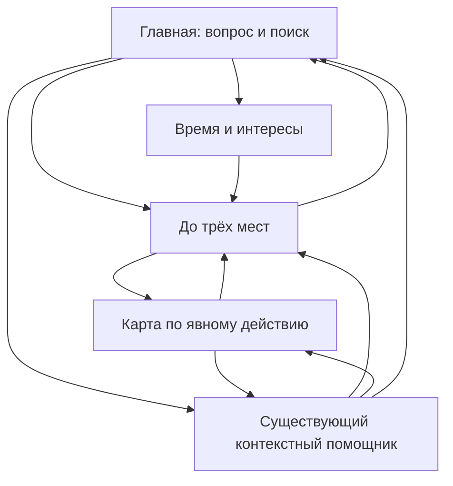

# AITU KEREK — Phase 4: Product Experience Rebuild

Проверено 17 октября 2026, Windows, Microsoft Edge. Работа выполнена в существующем проекте `C:\Users\ПК\Desktop\aitu-kerek-smartcity`. Этот отчёт объединяет реализацию, независимые ревью и фактически выполненные проверки. Исследование с реальными пользователями не проводилось.

## 1. Executive Summary

Главная переработана вокруг вопроса **«Куда хотите сходить?»**, большого поля и кнопки **«Найти место»**. Карта исчезла из начального экрана. Рядом доступны три понятных пути: найти место, подобрать прогулку по времени и интересам, обсудить пожелания с помощником.

Результаты — до трёх отдельных вариантов с названием, объяснением, данными расположения и явным действием «На карте». Карта открывается по запросу: desktop показывает список рядом, mobile — отдельный экран с возвратом. Точка старта, выбор, результаты и память существующего чата сохраняются при навигации. Browser Back работает без перезагрузки приложения.

Сохранены **549 реальных POI**, SQLite/SQLAlchemy, FastAPI и прежний Gemini RAG. Backend не менялся: независимая проверка подтвердила совпадение хешей всех 17 файлов `backend/app`. Импорт, миграции, Supabase, новые зависимости и Git push не выполнялись. Тестовые fixtures использовались только в изолированной временной базе.

Фактический итог: **145 pytest passed, 35 Playwright passed**, Ruff, ESLint, TypeScript и production build прошли. API smoke на настоящей базе и локальный fallback работают. Один ограниченный live smoke дал **две успешные генерации Gemini**. Реальные снимки с рабочей базой и тайлами OSM сделаны отдельно от детерминированных E2E.

## 2. Исходные проблемы UX/UI

До изменения прочитаны README, AGENTS, ARCHITECTURE, PHASE2_REPORT, PHASE3_REPORT, VERIFICATION, компоненты React, CSS, русские ресурсы, API-типы и useCityChat. Baseline запущен в настоящем Edge; desktop 1440×1000 и mobile 390×844 сняты до переписывания UI. Подложка baseline намеренно заменена однотонным тайлом, production DB не использовалась.

| Проблема | Фактическое наблюдение | Последствие |
|---|---|---|
| Карта первична | На 1440px около 69% ширины отдавалось карте; CityMap монтировался сразу | Основная задача терялась, тайлы запрашивались без намерения открыть карту |
| Длинный путь до CTA | Чат, старт, запрос, время, интересы и дополнительные фильтры предшествовали поиску | На 390×844 кнопка поиска была полностью ниже первого экрана |
| Мелкая типографика | Многие подписи и объяснения 9–13px | Слабая читаемость, особенно для пожилого новичка |
| Смешанные сценарии | Всё находилось в одной узкой панели | Быстрый поиск, планирование и диалог не различались |
| Неявная карта | Название карточки было кнопкой без видимой подписи действия | Новичок не мог предсказать результат нажатия |
| Потеря состояния | Бренд ссылался на `/` с reload | Возврат сбрасывал память и текущий результат |
| Случайная смена старта | Любой клик подложки вызывал pick и очищал подбор | Исследование карты могло разрушить результат |
| Технические ошибки | Сообщение предлагало запуск backend/localhost, пустая база — CLI | Пользователь получал невыполнимую для него инструкцию |

Решения приняты после исходного аудита, а не после переписывания. [Подробное независимое UX-ревью](phase4-ux-review.md).

## 3. Выбранная новая дизайн-концепция

Спокойный городской сервис: тёплый светлый фон, узнаваемый зелёный, ясная типографика и обычные действия с текстовыми названиями. Без декоративных градиентов, glassmorphism, случайных AI-иконок, маркетинговых секций и анимаций ради оформления.

Сохранён локальный **Golos Text** с кириллицей: замена на другую гарнитуру не давала необходимого выигрыша и потребовала бы новой зависимости. Основной текст 16px, пояснения преимущественно 14px; главная имеет выразительный заголовок, остальные экраны — компактную иерархию. Атрибуция Leaflet — исключение 12px, основной продуктовый текст таким размером не набран.

Единые CSS-токены: фон `#f6f4ee`, поверхность `#fffefb`, текст `#222f29`, зелёный `#285747`, вторичный текст `#58665e`, шаги отступов 8/16/24/32px. Основная кнопка минимум 52px высотой, остальные кнопки/summary — 44px. Видимы hover, focus, disabled и loading. Повторно используются FilterControls, ResultCard, Modal и существующий ChatPanel.

Служебная информация раскрывается по необходимости. Источник, часы, оценки дороги и ограничения остаются доступны, но не конкурируют с названием и причиной выбора. «Подбор без ИИ» остаётся на виду.

## 4. Новая информационная архитектура

Представления `home / plan / results / chat / map` используют общие origin, filters, response и selected. History API меняет представление без reload. Чат сохраняет сообщения и черновик в памяти вкладки. Навигация не равна сбросу: очистка происходит при явном изменении условий или «Новом диалоге», как требовал прежний контракт.

Карта загружается через React.lazy; Leaflet CSS тоже вынесен в динамический chunk. До открытия карты не создаётся Leaflet и не загружаются тайлы/ближайшие POI для скрытой карты. После первого открытия экземпляр сохраняется для удержания масштаба и панорамирования. Только новый выбор места вызывает его фокусировку, а новый набор результатов обновляет обзор.

Результаты и основной контент получают клавиатурный фокус после перехода. Закрытие модального окна возвращает фокус вызвавшей кнопке. Карта имеет собственную понятную кнопку возврата. Полная перезагрузка по-прежнему очищает память вкладки; долговременное хранение не добавлялось.

## 5. Сценарии A/B/C

| Сценарий | Реализованный путь | Действия и результат |
|---|---|---|
| A — найти место | Главная → запрос → «Найти место» → рекомендации | Два основных действия: ввод и отправка. До трёх вариантов; изменение старта/условий необязательно |
| B — спланировать время | Главная → «Подобрать прогулку» → время/интересы → «Подобрать места» | Открыть сценарий, выбрать нужные условия, отправить. Используется прежний recommendation engine |
| C — помощник | Главная → «Спросить помощника» → сообщение → подтверждение старта при необходимости → подбор | Существующий Gemini Chat помнит время, отрицания, близость и предпочтения; карточки доступны через «Посмотреть подбор» |

У всех путей общая SQLite и RAG-цепочка. При активном контексте обычный поиск использует его, сохраняя исключения; «Новый диалог» явно очищает контекст. Историческое место повторно проверяется сервером и только затем показывается на карте. Подтверждение названного старта не заменено автоматической геолокацией.

На карточке: имя, объяснение из проверенного ответа, адрес из SQLite или «Адрес не указан», расстояние **по прямой**, примерный бюджет, состояние часов и кнопка **«На карте»**. В подробностях — источник OSM, импорт, расписание, факты и оговорки. `closed` теперь отдельно отображается как «Закрыто по расписанию».

Время дороги приблизительное; отдельные варианты не соединяются в маршрут. На экранах планирования, результатов и карты это обозначено явно.

## 6. Отчёты специалистов и независимых проверяющих

Работали **основной агент и три реальных субагента**, максимум четыре одновременно. Десять требуемых ролей распределены между ними; отдельных десяти специалистов или участников исследования не было.

| Роль | Кто выполнял | Реальная работа и результат |
|---|---|---|
| Product Lead | Основной агент + ux_review | Анализ брифа, приоритизация главной, общий state и A/B/C |
| Senior UX Designer | ux_review | Независимые IA, before/after, критика навигации |
| Senior UI Designer | Основной агент; независимая проверка ux_review | Токены, типографика, композиция, адаптивность |
| Accessibility Specialist | ux_review + qa_browser | Цветовые пары, semantics, targets, focus, keyboard и reflow |
| React Frontend Engineer | Основной агент | App, FilterControls, карта, карточки, стили, ресурсы; reviewer отдельно улучшил LocationPicker/Modal |
| Backend Integration Engineer | backend_review | Контракт API, hashes backend, реальный Gemini и fallback |
| QA Automation Engineer | qa_browser | Baseline, адаптация старых регрессий, новые E2E и снимки четырёх ширин |
| UX Research Reviewer | ux_review | Эвристические перспективы трёх возрастных групп; без реальных участников |
| Mobile UX Specialist | ux_review + qa_browser | 320/390/768px, первая кнопка, fullscreen map, composer, overflow |
| Security & Reliability Reviewer | backend_review | Секреты, факты SQLite, late responses, безопасная диагностика и отсутствие backend-регрессий |

Независимые замечания привели к исправлениям: защита старта от случайного клика карты; отдельное `closed`; сохранение viewport при повторном открытии; отсутствие скрытого chat-запроса при выборе старта с главной; запрет позднему историческому ответу открыть карту после browser Back; видимость ответа unsupported в обычном поиске с контекстом; возврат фокуса после Escape. После визуальной критики начальное поле чата перенесено выше welcome/examples — теперь оно видно на первом экране 320/390px.

Полные первичные отчёты: [UX/UI/accessibility/mobile](phase4-ux-review.md), [backend/security/reliability](phase4-backend-review.md), [браузерный QA](phase4-qa-review.md). Ревьюеры не объявляли интерфейс идеальным.

## 7. Accessibility audit

Цель — применимые требования WCAG 2.2 AA; полное соответствие не сертифицировано. Для порогов использованы первичные материалы W3C: [контраст 1.4.3](https://www.w3.org/WAI/WCAG22/Understanding/contrast-minimum.html), [reflow 1.4.10](https://www.w3.org/WAI/WCAG22/Understanding/reflow.html), [размер цели 2.5.8](https://www.w3.org/WAI/WCAG22/Understanding/target-size-minimum.html).

| Проверка | Результат / граница |
|---|---|
| Контраст текста | Проверенные основные пары выше 4.5:1; см. расчёт ниже |
| Размеры действий | Основная кнопка 52px, обычные кнопки/summary минимум 44px; zoom controls карты 44px |
| Keyboard | Поиск Enter, Escape из dialog с возвратом фокуса, переход фокуса к результатам проверены браузером; видимый 3px focus ring |
| Semantics | `lang=ru`, label/fieldset/legend, aria-pressed, native dialog, role=log/status/alert; есть skip link |
| Перенос и мобильный экран | 320/390/768/1440px: нет горизонтального overflow в проверенных путях |
| Увеличение | Реальный layout с CSS zoom 200% прошёл поиск/результаты; это не ручной browser chrome zoom и не OS scaling |
| Motion | prefers-reduced-motion отключает анимации; переходы не используют декоративное движение |
| Текстовые альтернативы карте | Список, название/адрес, выбранное место и источник доступны вне графической карты |

Независимый расчёт sRGB по фактическим CSS-цветам:

| Пара | Контраст |
|---|---:|
| Основной текст / бумажный фон | 12.67:1 |
| Вторичный текст / бумажный фон | 5.49:1 |
| Текст основной кнопки / зелёный | 8.18:1 |
| Вторичный текст / выбранная карточка | 5.29:1 |
| Текст fallback / его фон | 6.80:1 |
| Ошибка / её фон | 6.61:1 |
| Граница поля / поверхность | 3.11:1 |

Это конкретные пары, не аудит каждого пикселя, внешней подложки или всех состояний. Screen reader NVDA/JAWS/VoiceOver, реальная мобильная клавиатура, реальные устройства и участники с нарушениями зрения не проверялись. Возврат из карты фокусирует результаты, а не точную прежнюю кнопку/scroll — возможное дальнейшее улучшение.

## 8. Functional regression review

- 549 мест сохранились; аудит после реализации снова дал ноль нарушений источников, bbox, классификатора и правила дублей. 416 POI без часов, 56 с неподдерживаемым расписанием и один `fee=no` — прежние ограничения данных.
- Backend/app: хеши **17/17** файлов совпали с исходным состоянием. SQLite-схема, Overpass CLI, атомарность импорта, SQLAlchemy и FastAPI не изменялись.
- Сохранён `response_json_schema=GeneratedPlan.model_json_schema()`, Pydantic extra-forbid, проверка ID/разрешённых причин/действий и независимый grounding.
- Чат использует прежний useCityChat: восемь видимых сообщений, ограниченные preferences/ID, отрицания, время, близость, новые/прошлые варианты, подтверждение старта и локальный fallback. Протокол не заменён.
- Отмена и идентичность запроса защищают от позднего ответа. Нельзя двойным Enter отправить два запроса; долгий/ошибочный запрос имеет понятный повтор.
- Режим «без ИИ» виден. В реальных smoke source URL, уникальность, бюджет и unknown-часы проверены отдельно от интерфейса.
- Секреты остались на backend. Новое логирование запросов, координат, raw SDK exceptions и пользовательского текста не добавлялось. Геолокация вызывается только отдельной кнопкой.
- Никакого HTTP-импорта, Supabase, auth, миграции DB, нового AI engine или внешнего хранилища сообщений не добавлено.

## 9. Результаты автоматических тестов

| Проверка | Фактический итог |
|---|---|
| `.venv/Scripts/python.exe -m pytest backend/tests -q` | **145 passed**, два прежних предупреждения зависимостей |
| `.venv/Scripts/python.exe -m ruff check backend scripts` | **All checks passed** |
| `npm --prefix frontend run lint` | **Passed** |
| `npm --prefix frontend run typecheck` | **Passed** |
| `npm --prefix frontend run build` | **Passed**, production Vite + TypeScript |
| `npm --prefix frontend run test:e2e` | **35 passed**, Microsoft Edge, примерно 1,1 мин |
| Финальные адресные проверки после переноса поля чата | **5 passed**, 12,7 с; снимки обновлены |
| API smoke, реальные данные, backend без Gemini | **Passed**: A/B/C, подтверждения, источники, ID и время |
| Chat fallback smoke | **Passed**, `mode=local`, `fallback_reason=missing_key` |
| Один live `chat_smoke.py --require-gemini` | **2/2 генерации Gemini**, `fallback_reason=null`; 3 затем 1 результат |
| `scripts/audit_data.py` | **549 POI**, 0 нарушений проверенных инвариантов |
| Независимые targeted browser cases backend_review | **Passed**: hidden-chat/draft, unsupported, delayed historical response после Back, карта/viewport |
| Реальные данные + OSM tiles, 1440/390px | **0 page errors**, начальные map/tiles=0, по 3 результата, без горизонтального overflow |

35 E2E сохраняют прежние смысловые регрессии и добавляют главную без карты/геолокации, A/B/C, map/back, browser Back, explicit picking, viewport, сохранение черновика после незавершённого подтверждения, ошибки/empty database, keyboard/dialog focus, mobile widths и CSS zoom. Все тесты запускают настоящий FastAPI с временной изолированной SQLite; Gemini отключён, тайлы подменены, чтобы повторными прогонами не нагружать OSM.

Первый прогон обновлённых тестов: 25/33, без объявления успеха. Адаптированы селекторы новых представлений и ожидание lazy-map; выявленный настоящий дефект focus после Escape исправлен. Затем добавлены две содержательные регрессии и полный прогон **35/35** завершился успешно. Позднейшие адресные снимки проверяли изменённое расположение поля чата, не подменяя полный прогон.

Среда: первые sandbox-попытки pytest столкнулись с Windows TEMP/TestClient, браузер — с TEMP/localhost. Успешные проверки выполнены после разрешённого запуска тех же локальных инструментов вне ограничения sandbox. Ошибочные или зависшие попытки не посчитаны пройденными. Новых пакетов не устанавливалось. Два Python warnings относятся к Google SDK `_UnionGenericAlias` и Starlette/httpx2; Playwright также может предупреждать о NO_COLOR/FORCE_COLOR.

Build подтверждает отдельные **CityMap JS ≈160.06 kB, CSS ≈15.09 kB** (до gzip); они не загружаются на главной. Основной JS ≈277.90 kB, gzip ≈86.85 kB. Это текущие измерения, не обещание конкретного Lighthouse-score или времени загрузки на чужом устройстве.

## 10. Desktop/mobile screenshots

**Baseline — исходный UI, изолированные fixtures, tile stub:** [desktop 1440](screenshots/phase4-before-desktop-1440.png), [mobile 390](screenshots/phase4-before-mobile-390.png).

**Финальный продукт с настоящими 549 местами и OSM-картой**, отдельный API без Gemini, явно видимый fallback:

| Экран | Desktop 1440 | Mobile 390 |
|---|---|---|
| Главная | [Открыть](screenshots/phase4-real-home-1440.png) | [Открыть](screenshots/phase4-real-home-390.png) |
| Прогулка B | [Открыть](screenshots/phase4-real-plan-1440.png) | [Открыть](screenshots/phase4-real-plan-390.png) |
| Вход в помощник C | [Открыть](screenshots/phase4-real-chat-entry-1440.png) | [Открыть](screenshots/phase4-real-chat-entry-390.png) |
| Результаты | [Открыть](screenshots/phase4-real-results-1440.png) | [Открыть](screenshots/phase4-real-results-390.png) |
| Карта | [Открыть](screenshots/phase4-real-map-1440.png) | [Открыть](screenshots/phase4-real-map-390.png) |
| Диалог | [Открыть](screenshots/phase4-real-chat-1440.png) | [Открыть](screenshots/phase4-real-chat-390.png) |

Реальные browser interactions и снимки воспроизводит `scripts/phase4_visual.mjs` при работающих 5175→8003. [Безопасные числовые результаты наблюдения](screenshots/phase4-real-observations.json): 0 page errors, 0 начальных тайлов и Leaflet, noOverflow=true; реальные тайлы при открытии карты загрузились без tileError. © OpenStreetMap contributors, ODbL.

**Детерминированные E2E-снимки** используют только временные fixtures и tile stub; слова Fixture на них не являются production-данными:

| Ширина | Главная | Результаты | Карта | Чат |
|---|---|---|---|---|
| 320px | [PNG](screenshots/phase4-after-home-320.png) | [PNG](screenshots/phase4-after-results-320.png) | [PNG](screenshots/phase4-after-map-320.png) | [PNG](screenshots/phase4-after-chat-320.png) |
| 390px | [PNG](screenshots/phase4-after-home-390.png) | [PNG](screenshots/phase4-after-results-390.png) | [PNG](screenshots/phase4-after-map-390.png) | [PNG](screenshots/phase4-after-chat-390.png) |
| 768px | [PNG](screenshots/phase4-after-home-768.png) | [PNG](screenshots/phase4-after-results-768.png) | [PNG](screenshots/phase4-after-map-768.png) | [PNG](screenshots/phase4-after-chat-768.png) |
| 1440px | [PNG](screenshots/phase4-after-home-1440.png) | [PNG](screenshots/phase4-after-results-1440.png) | [PNG](screenshots/phase4-after-map-1440.png) | [PNG](screenshots/phase4-after-chat-1440.png) |

[Увеличение CSS 200%](screenshots/phase4-after-zoom-200.png). Снимки являются реальным браузерным рендером, а не макетами или генерацией изображений.

## 11. Оценки до и после

Шкала 1–10 — экспертные эвристические оценки независимых агентов. 10 означает отсутствие существенных известных барьеров в проверенном сценарии; ни одна оценка не выдана автоматически и не является результатом интервью или замера конверсии.

| Направление | До | После | Почему изменилось / что ограничивает |
|---|---:|---:|---|
| Первый полезный результат | 5 | 8 | Прямой ввод и CTA вместо длинной панели; конфликт текстового времени ещё требует подтверждения |
| Структура и возврат | 4 | 8 | Явные A/B/C, внутренние переходы и Back; точный старый scroll/кнопка ещё не восстанавливаются |
| Визуальная иерархия | 5 | 8 | Главная сфокусирована на запросе; внутри отдельного чата ещё есть повторный раскрывающий заголовок |
| Читаемость | 3 | 9 | 16/14px, крупные названия, измеренный контраст и отсутствие обрезки |
| Доступность, ограниченный аудит | 5 | 8 | Семантика, focus, targets, reflow; без полноценного screen-reader/реального user testing |
| Mobile UX | 4 | 8 | CTA и начальное поле чата в первом экране, карта с возвратом; настоящая мобильная клавиатура не проверялась |
| Прозрачность результата | 7 | 8 | Источник и unknown сохранены, карточки проще; данные OSM остаются неполными |
| Backend-интеграция | 8 | 9 | Общий pipeline сохранён, live/fallback и регрессии подтверждены |
| Факты и приватность | 8 | 8 | Сильные прежние гарантии сохранены; достоверность OSM на местности не повысилась от redesign |
| Предсказуемость карты | 5 | 8 | Lazy вход, explicit picking, viewport regression; мобильная карта зависит от внешних тайлов |
| Честность состояний данных | 7 | 9 | Unknown/fallback сохранены, closed исправлен, ошибки доступны обычному пользователю |

Эвристические перспективы трёх новичков. Порядок значений: **первый экран / действие / число шагов / читаемость / возврат / результат**.

| Перспектива | До /10 | После /10 | Объяснение |
|---|---|---|---|
| Школьник впервые | 5 / 5 / 6 / 5 / 4 / 6 | 9 / 9 / 8 / 9 / 8 / 8 | Прямой вопрос, знакомое поле, действия названы глаголами; ограничения AI ещё требуют понимания |
| Студент за минуту | 5 / 6 / 5 / 5 / 5 / 6 | 9 / 9 / 9 / 9 / 8 / 8 | Может сразу выполнить A и открыть только нужную карту, без настройки всего сервиса |
| Пожилой новичок | 3 / 4 / 4 / 2 / 3 / 4 | 8 / 9 / 8 / 8 / 8 / 8 | Крупный текст, явные кнопки и отсутствие случайной смены старта; приблизительное время/диалог стоит проверить лично |

Полные исходные оценки этих перспектив и причины приведены в [независимом UX-review](phase4-ux-review.md). Это не настоящее пользовательское исследование и не доказательство выполнения задачи за минуту живым участником.

## 12. Критические оставшиеся проблемы

**Блокирующих дефектов в проверенном объёме Phase 4 не обнаружено после исправлений.** Это не утверждение об отсутствии всех возможных ошибок.

Существенные границы: нет дорожной маршрутизации, проверки входов/переходов, актуальной доступности заведений или гарантии часов/цен. Сложная естественная речь ограничена прежними правилами. Gemini зависит от внешнего сервиса, память — от текущей вкладки. Full WCAG certification, NVDA/VoiceOver, реальный phone/keyboard, чистая установка на другом ПК и публичный production deployment не проверены.

В sandbox ограничения TEMP/localhost потребовали разрешённого запуска тестов вне песочницы. В рабочей папке отсутствует `.git`, поэтому Git diff/commit не использовались; Git push не выполнялся. Основной уже работавший backend8000 сохранён. При завершении проверок собственные QA Vite5175 и API8003 остановлены после проверки принадлежности процессов; E2E-серверы завершены Playwright. Снимки и отчёты остаются доступны без этих серверов.

## 13. Рекомендации для Phase 5

1. Провести короткие реальные сессии со школьником, студентом и пожилым участником: первая задача без объяснений, завершение A/B/C, понимание fallback и приблизительного времени.
2. Проверить NVDA/VoiceOver, browser zoom 200–400%, реальную мобильную клавиатуру и touch. Уточнить focus/scroll restore после возврата к конкретной карточке.
3. Упростить раскрывающий заголовок внутри отдельного чата, добавить более точные ориентиры только из проверенного источника; не подменять неизвестные адреса догадками.
4. Реализовать запланированные Supabase Auth/PostgreSQL отдельно: миграции, политика хранения, защита API, rate limits и проверка безопасности до публичного запуска. В Phase 4 это не внедрялось.
5. Если появится настоящий routing provider, отдельно валидировать пути/входы/переходы. До этого сохранять формулировки «по прямой» и «оценка».

Изменённые продуктовые файлы: App, styles, ru, FilterControls, ResultCard, CityMap, ChatPanel (расположение стартового ввода), LocationPicker, Modal, api и main. Обновлены discovery/chat E2E, README, ARCHITECTURE; добавлены этот отчёт, независимые ревью, visual QA script и снимки. Backend/useCityChat/данные не переписывались.
